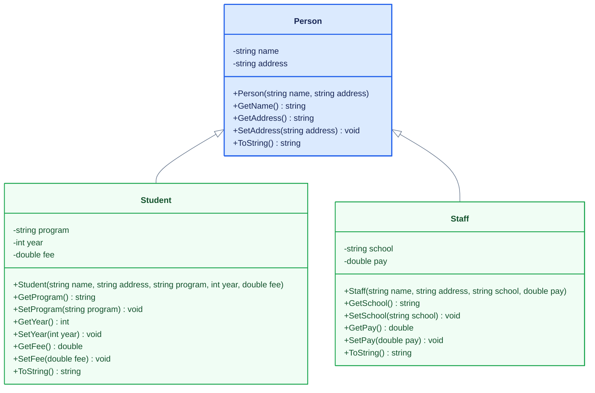
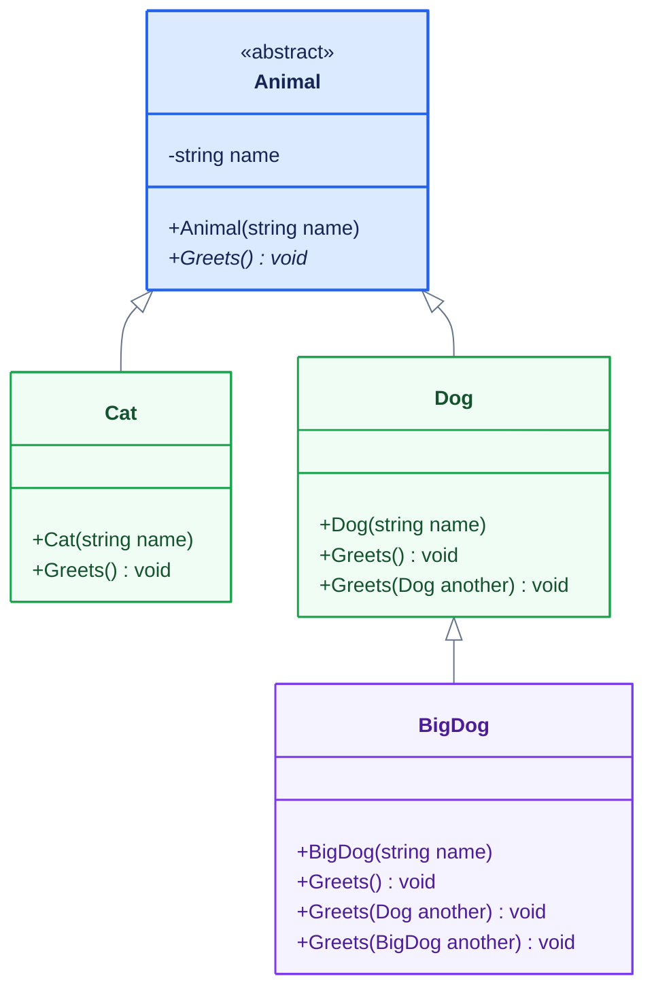

# Week 03 — C# Practice

> **Topics:** Inheritance · Encapsulation · Abstraction · Polymorphism · Collections

| Language | Язык / Забон |
| :---: | :--- |
| RU | [Русская версия](#русская-версия) |
| TJ | [Тоҷикӣ](#версияи-тоҷикӣ) |

---

# Русская версия

## Task 1 — Inheritance

### Наследование

Создайте классы `Person`, `Student` и `Staff` согласно UML-диаграмме.

Классы `Student` и `Staff` должны наследоваться от класса `Person`.

### UML Diagram



### Требования

- Создайте все поля, конструкторы и методы, указанные на диаграмме.
- Все поля должны быть `private`.
- Все методы и конструкторы должны быть `public`.
- Используйте `base(...)` в конструкторах дочерних классов.
- Реализуйте методы получения и изменения данных (`Get` и `Set`).
- Для поля `name` реализуйте только метод `GetName()`.
- Переопределите метод `ToString()` с помощью `override` во всех трёх классах.
- В методах `ToString()` дочерних классов используйте `base.ToString()`.
- В `Program.cs` создайте объекты всех трёх классов и проверьте работу методов.

### Expected Output

Метод `ToString()` каждого класса должен возвращать строку в следующем формате:

**Person**

```text
Person[name=?,address=?]
```

**Student**

```text
Student[Person[name=?,address=?],program=?,year=?,fee=?]
```

**Staff**

```text
Staff[Person[name=?,address=?],school=?,pay=?]
```

> Вместо символов `?` должны выводиться соответствующие значения полей объекта.

---

## Task 2 — Abstraction & Polymorphism

### Абстракция и полиморфизм

Создайте абстрактный класс `Animal` и классы `Cat`, `Dog` и `BigDog` согласно UML-диаграмме.

- `Cat` наследуется от `Animal`.
- `Dog` наследуется от `Animal`.
- `BigDog` наследуется от `Dog`.

### UML Diagram



### Требования

- Создайте абстрактный класс `Animal`.
- В классе `Animal` создайте приватное поле `name`, конструктор и абстрактный метод `Greets()`.
- Реализуйте все конструкторы согласно диаграмме, используя `base(...)`.
- Используйте `override` для переопределения метода `Greets()`.
- В классе `Dog` объявите метод `Greets(Dog another)` как `virtual`.
- В классе `BigDog` переопределите метод `Greets(Dog another)` с помощью `override`.
- Реализуйте перегрузку метода `Greets(BigDog another)` в классе `BigDog`.
- Каждый метод должен выводить соответствующий текст через `Console.WriteLine()`.
- В `Program.cs` создайте объекты классов `Cat`, `Dog` и `BigDog` и проверьте все методы.
- Проверьте вызов метода `Greets()` через переменную типа `Animal`.

### Expected Output

| Class | Method | Console Output |
| :--- | :--- | :--- |
| `Cat` | `Greets()` | `Meow` |
| `Dog` | `Greets()` | `Woof` |
| `Dog` | `Greets(Dog another)` | `Woooof` |
| `BigDog` | `Greets()` | `Wooow` |
| `BigDog` | `Greets(Dog another)` | `Woooooow` |
| `BigDog` | `Greets(BigDog another)` | `Wooooooooow` |

---

## Task 3 — Collections

### Работа со списками

Дан следующий список целых чисел:

```csharp
List<int> list = new List<int>()
{
    3, 0, 7, -2, 7, 15, -60, 32,
    0, -2, 90, 32, 55, 8, -9
};
```

### Задания

| № | Описание |
| :---: | :--- |
| 01 | Найдите и выведите наименьшее число из списка. |
| 02 | Удалите повторяющиеся элементы, оставив по одному экземпляру каждого числа. |
| 03 | Отсортируйте список в порядке убывания. |
| 04 | Замените все отрицательные числа на `0`. |

### Требования

- Выполните все четыре операции последовательно.
- После каждой операции выведите полученный результат в консоль.

---

### UML — Условные обозначения

| Обозначение | Описание |
| :---: | :--- |
| `+` | Public — публичный член класса |
| `-` | Private — приватный член класса |
| `*` | Abstract — абстрактный метод |
| `«abstract»` | Абстрактный класс |
| `△` | Наследование — указатель на родительский класс |

---

# Версияи тоҷикӣ

## Task 1 — Inheritance

### Меросгирӣ

Мувофиқи диаграммаи UML классҳои `Person`, `Student` ва `Staff`-ро созед.

Классҳои `Student` ва `Staff` бояд аз класси `Person` мерос гиранд.

### UML Diagram


### Талабот

- Ҳамаи майдонҳо, конструкторҳо ва методҳои дар диаграмма нишондодашударо созед.
- Ҳамаи майдонҳо бояд `private` бошанд.
- Ҳамаи методҳо ва конструкторҳо бояд `public` бошанд.
- Дар конструкторҳои классҳои ворис аз `base(...)` истифода баред.
- Методҳои гирифтан ва тағйир додани маълумотро (`Get` ва `Set`) амалӣ кунед.
- Барои майдони `name` танҳо методи `GetName()`-ро созед.
- Методи `ToString()`-ро дар ҳар се класс бо истифода аз `override` аз нав муайян кунед.
- Дар методҳои `ToString()`-и классҳои ворис аз `base.ToString()` истифода баред.
- Дар `Program.cs` объектҳои ҳар се классро созед ва кори методҳоро санҷед.

### Натиҷаи интизоршаванда

Методи `ToString()`-и ҳар як класс бояд сатрро дар формати зерин баргардонад:

**Person**

```text
Person[name=?,address=?]
```

**Student**

```text
Student[Person[name=?,address=?],program=?,year=?,fee=?]
```

**Staff**

```text
Staff[Person[name=?,address=?],school=?,pay=?]
```

> Ба ҷойи аломатҳои `?` бояд қиматҳои мувофиқи майдонҳои объект бароварда шаванд.

---

## Task 2 — Abstraction & Polymorphism

### Абстраксия ва полиморфизм

Мувофиқи диаграммаи UML класси абстрактии `Animal` ва классҳои `Cat`, `Dog` ва `BigDog`-ро созед.

- Класси `Cat` аз `Animal` мерос мегирад.
- Класси `Dog` аз `Animal` мерос мегирад.
- Класси `BigDog` аз `Dog` мерос мегирад.

### UML Diagram


### Талабот

- Класси абстрактии `Animal`-ро созед.
- Дар класси `Animal` майдони хусусии `name`, конструктор ва методи абстрактии `Greets()`-ро созед.
- Ҳамаи конструкторҳоро мувофиқи диаграмма бо истифода аз `base(...)` амалӣ кунед.
- Барои аз нав муайян кардани методи `Greets()` аз `override` истифода баред.
- Дар класси `Dog` методи `Greets(Dog another)`-ро ҳамчун `virtual` эълон кунед.
- Дар класси `BigDog` методи `Greets(Dog another)`-ро бо истифода аз `override` аз нав муайян кунед.
- Дар класси `BigDog` перегрузкаи методи `Greets(BigDog another)`-ро амалӣ кунед.
- Ҳар як метод бояд матни мувофиқро тавассути `Console.WriteLine()` ба экран барорад.
- Дар `Program.cs` объектҳои классҳои `Cat`, `Dog` ва `BigDog`-ро созед ва ҳамаи методҳоро санҷед.
- Даъвати методи `Greets()`-ро тавассути тағйирёбандаи навъи `Animal` санҷед.

### Натиҷаи интизоршаванда

| Класс | Метод | Натиҷа |
| :--- | :--- | :--- |
| `Cat` | `Greets()` | `Meow` |
| `Dog` | `Greets()` | `Woof` |
| `Dog` | `Greets(Dog another)` | `Woooof` |
| `BigDog` | `Greets()` | `Wooow` |
| `BigDog` | `Greets(Dog another)` | `Woooooow` |
| `BigDog` | `Greets(BigDog another)` | `Wooooooooow` |

---

## Task 3 — Collections

### Кор бо рӯйхатҳо

Рӯйхати зерини ададҳои бутун дода шудааст:

```csharp
List<int> list = new List<int>()
{
    3, 0, 7, -2, 7, 15, -60, 32,
    0, -2, 90, 32, 55, 8, -9
};
```

### Супоришҳо

| № | Шарҳи супориш |
| :---: | :--- |
| 01 | Адади хурдтаринро аз рӯйхат ёфта, ба экран бароред. |
| 02 | Элементҳои такроршавандаро аз рӯйхат нест кунед, то аз ҳар адад танҳо як нусха боқӣ монад. |
| 03 | Рӯйхатро бо тартиби камшавӣ мураттаб кунед. |
| 04 | Ҳамаи ададҳои манфиро бо `0` иваз кунед. |

### Талабот

- Ҳамаи чор амалро пайдарпай иҷро кунед.
- Пас аз ҳар як амал натиҷаи ҳосилшударо ба консол бароред.

---

### UML — Аломатҳои шартӣ

| Аломат | Шарҳ |
| :---: | :--- |
| `+` | Public — узви дастраси класс |
| `-` | Private — узви хусусии класс |
| `*` | Abstract — методи абстрактӣ |
| `«abstract»` | Класси абстрактӣ |
| `△` | Меросгирӣ — ишора ба класси асосӣ |

---

<div align="center">

**C# · Week 03 · Practice Tasks**

Good luck! / Барори кор!

</div>
